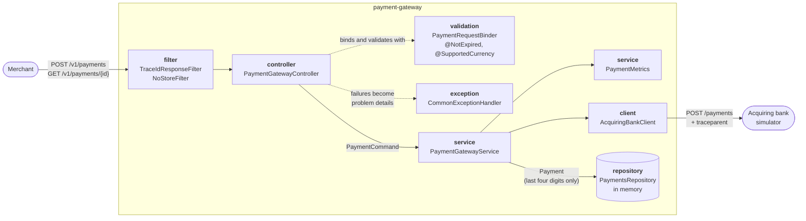
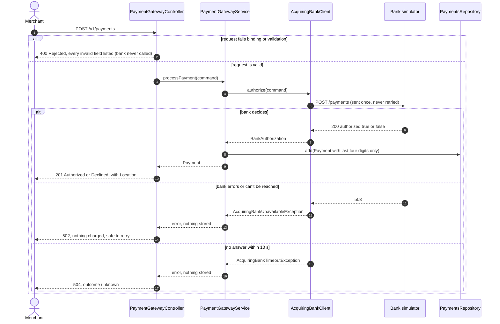

# Design

This document explains how the gateway is built, the assumptions behind it and what was left out
on purpose. The brief asks for something simple and maintainable that meets the functional
requirements, so the scope is the two required operations, built to the standard a production
service needs: safe with card data, observable, packaged and tested. Everything beyond that is
listed under [Not built yet](#not-built-yet) with the reasoning.

Decisions with longer-lasting consequences have their own records in [adr/](adr/). How to run
the service and respond to incidents is in the [runbook](RUNBOOK.md).

## Architecture

The code keeps the skeleton's layered layout: the controller handles HTTP, the service owns the
payment flow, and the client and repository talk to the bank and storage. These are concrete
classes, with no interfaces in front of them. Each has exactly one implementation, and the
tests replace them with Mockito, WireMock or the real class. An interface would be extracted
when a second implementation actually appears, for example a second acquiring bank or a
database.

Each layer has its own model:

| Model                | Package | Holds the full card number? | Notes                                      |
|----------------------|---------|-----------------------------|--------------------------------------------|
| `PostPaymentRequest` | model   | Yes, for the request only   | Validation rules live here                 |
| `PaymentCommand`     | model   | Yes, for the request only   | What the service needs to charge a card    |
| `BankPaymentRequest` | client  | Yes, sent to the bank       | The bank's wire format, field names pinned |
| `Payment`            | model   | **No**, last four only      | The only thing ever stored                 |
| `PaymentResponse`    | model   | **No**, last four only      | What merchants see                         |

Separate models cost a few mapping lines. In return, the API, the bank format and storage can
change independently, and card data can't reach storage or a response by accident, because the
types that get stored and returned have no field for it.

### Processing a payment

- **Rejected** means the request broke a validation rule. The bank is never called and nothing
  is stored.
- **Authorized** and **Declined** are both the bank's decision. The payment gets a new gateway
  UUID and is stored with the last four card digits only.
- **502** means the bank answered with an error or couldn't be reached, so no money moved and
  the merchant can retry. **504** means the bank didn't answer in time. It may still have
  authorized the payment, so the merchant is told the outcome is unknown. The bank call is
  never retried ([ADR-0003](adr/0003-no-retries-on-payment-requests.md)).

The whole flow is non-blocking ([ADR-0001](adr/0001-reactive-webflux.md)).

## API design

- **Resource-oriented and versioned:** `POST /v1/payments` and `GET /v1/payments/{id}`. The
  `/v1` prefix leaves room for a breaking change without breaking existing merchants.
- **Status codes carry the outcome class:** `201` for a payment the bank decided on, `400` for
  Rejected, `404` for an unknown id, `502` and `504` for the two bank failures. A merchant can
  branch on the status code alone.
- **Authorized and Declined both return `201`.** A decline is a valid business outcome, not an
  error: a payment was created and can be retrieved. The `status` field says which it was.
- **Rejected is visible in the body as well as the status.** The brief names Rejected as one of
  three outcomes, so error bodies carry `"payment_status": "Rejected"`. It's not `status`,
  because in a problem detail that field is the HTTP status code.
- **Errors are [RFC 9457](https://www.rfc-editor.org/rfc/rfc9457) problem details** with
  `application/problem+json`. Validation errors list every failing field at once, by its JSON
  name, so a merchant can fix a request in one go. Internal details (stack traces, bank
  responses) never reach the response.
- **snake_case JSON**, the same as the bank's API and Checkout.com's public API.
- **`Cache-Control: no-store`** on every payment response, so browsers, proxies and CDNs don't
  keep payment details.
- **`X-Trace-Id`** on every payment response: a merchant reporting a problem can quote it, and it finds
  the request's logs and trace.
- **Documented with OpenAPI**, generated from the code (`/swagger-ui.html`), so the docs can't
  drift from the implementation.

## Validation rules and assumptions

The brief's rules are implemented as written. Where it left room for interpretation:

**Every invalid field is reported at once.** The controller reads the POST body as raw JSON and
hands it to `PaymentRequestBinder`, which checks each field's JSON type and then runs Bean
Validation on the result. Binding straight to the record would stop at the first field of the
wrong type (for example `"amount": 10.5`) and never check the others. A field of the wrong type is
reported as such (`must be a string`, `must be a whole number`) and its other rules are skipped;
all remaining fields are still validated. Text fields must be JSON strings, so a CVV such as `012`
can't lose its leading zero.

| Field        | Rule                                    | Assumption or reason                                             |
|--------------|-----------------------------------------|------------------------------------------------------------------|
| Card number  | 14–19 digits, digits only               | Spaces and dashes are rejected, not stripped. No Luhn check: the brief doesn't ask for one and the simulator's test cards needn't pass it |
| Expiry month | 1–12                                    |                                                                  |
| Expiry year  | Month and year together not in the past | **A card is valid until the end of its expiry month**, so the current month is accepted. "Now" is UTC, from an injected `Clock` |
| Currency     | `USD`, `GBP` or `EUR`                   | The brief asks for no more than 3 codes. Codes are case-sensitive (`gbp` is rejected), as ISO 4217 defines them in upper case |
| Amount       | Integer, greater than 0                 | `10.5` is rejected rather than truncated to `10`. Zero-amount card verification isn't in scope |
| CVV          | 3–4 digits, digits only                 | Kept as a string so leading zeros (`012`) survive                 |

Other assumptions:

- **Rejected payments are not stored.** The brief says no payment is created, and retrieval only
  ever returns Authorized or Declined. Rejections are counted in metrics instead.
- **Payment ids are generated by the gateway** (random UUIDs), not taken from the bank's
  `authorization_code`. Ids belong to our API, shouldn't expose a bank reference, and a declined
  payment has no authorization code at all.
- **The last four digits are a string**, so a card ending `0042` doesn't come back as `42`.
- **A 4xx from the bank is reported to the merchant as a 502**, not passed on. Validation should
  prevent it, so if it happens the gateway sent a bad request. That's our fault, not the
  merchant's, and it's logged as a warning.
- **Any merchant can read any payment.** There is no authentication yet, see below.

## Observability

The aim is that, when something goes wrong, an engineer can answer "what happened to payment X?"
and "is the bank healthy?" from the outside.

- **Logs.** In Docker, every line is a JSON object in Elastic Common Schema, ready for a log
  pipeline. Running locally, logs are plain text for readability. Every line carries `traceId`
  and `spanId`, including lines written on Reactor I/O threads (automatic context propagation).
  Each payment outcome is logged once with structured fields: `payment_id`, `payment_status`,
  `amount`, `currency`, `card_last_four`. **Card numbers and CVVs are never logged:** the request
  and command types mask them in `toString()`, and tests check this.
- **Metrics** (Prometheus, `/actuator/prometheus`):
  - `payments_processed_total{status=authorized|declined|rejected}`: the business view.
  - `payments_bank_failures_total`: bank errors and timeouts.
  - `http_client_requests_seconds{uri="/payments",status,outcome}`: bank latency and error rate,
    built in.
  - `http_server_requests_seconds`: the gateway's own latency and status codes, built in.
  - Every meter is tagged `application=payment-gateway`.
- **Traces** (OpenTelemetry). One trace per request, with a child span for the bank call. The
  trace is passed to the bank in a W3C `traceparent` header, so a bank that also traces would
  join it. Sampling is 100%, which a high-traffic deployment would lower. Requests to `/actuator`
  aren't observed, so health probes and scrapes don't bury payment traces or skew latency
  metrics. Export is off unless an OTLP endpoint is configured; the observability compose
  overlay does that and adds Grafana.
- **Health.** `/actuator/health/liveness` and `/readiness` for an orchestrator. **The bank is not
  part of readiness.** If it were, a bank outage would pull every gateway instance out of the
  load balancer at once and turn a partial outage into a total one. The gateway stays up and
  reports the failure per request with a `502`, and the bank failure metric shows it.

A sensible first set of alerts: rising `payments_bank_failures_total`, bank p99 latency
approaching the 10 s response timeout, and a surge in Rejected (often a merchant integration
broken by a release).

## Packaging and hosting

- **Container image.** A multi-stage `Dockerfile` builds the jar with Gradle and runs it on a JRE-only Alpine
  image as a non-root user. The jar is split into layers (dependencies first, application code
  last), so a code change rebuilds and ships only a small final layer. The image has a
  `HEALTHCHECK` on the readiness probe, and the JVM sizes its heap from the container's memory
  limit (`MaxRAMPercentage=75`).
- **Configuration** comes from the environment (`BANK_BASE_URL`, timeouts, port), so the same
  image runs anywhere. The bank URL is checked at startup: a value Java can't parse (for
  example a hostname with an underscore) stops the app at boot instead of failing the first
  payment.
- **docker compose** runs the gateway next to the skeleton's simulator service. The gateway
  reaches it through a `bank-simulator` network alias, since `bank_simulator` isn't a valid
  hostname. An optional overlay
  (`docker-compose.observability.yml`) adds Grafana, Tempo and Prometheus.
- **CI** (GitHub Actions) runs every test layer, including the end-to-end tests in Docker,
  publishes test and coverage reports, and builds the image.

**Stateless except for storage.** The in-memory repository is the one thing that stops the
gateway from scaling to several instances, because each would have its own payments. Swapping it
for a shared database is a change to one class
([ADR-0002](adr/0002-in-memory-storage.md)).

## Testing strategy

The tests are layered so that each kind of mistake is caught by the cheapest test that can catch
it:

| Layer         | Test class                                           | Catches                                                     |
|---------------|------------------------------------------------------|-------------------------------------------------------------|
| Unit          | `PaymentRequestBinderTest`                           | Wrong-typed fields and failed rules reported together; null, missing and oversized values |
|               | `PostPaymentRequestValidationTest`                   | Each validation rule at its boundaries (14 vs 13 digits, this month vs last month, December to January), against a fixed date |
|               | `PaymentGatewayServiceTest`                          | Outcome mapping; a bank failure stores nothing; metrics recorded |
|               | `PaymentsRepositoryTest`, `BankPropertiesTest`        | Storage semantics; a bad bank URL fails at startup          |
| Bank contract | `AcquiringBankClientTest` (WireMock)                 | The exact JSON sent to the bank, `MM/YYYY` expiry formatting, each failure mode, and that a failed request is sent **once** |
| HTTP contract | `PaymentGatewayControllerTest` (`@WebFluxTest`)      | Status codes, JSON names, problem details, headers, and that the card number never appears in a response |
| Component     | `PaymentGatewayComponentTest` (whole app + WireMock) | Wiring and configuration, trace propagation to the bank, metrics exposure. No Docker needed |
| End to end    | `PaymentGatewayIT` (Testcontainers + Mountebank)     | Authorized, declined, bank error and retrieval against the **real** simulator |

Choices worth noting:

- **Time is injected.** Expiry validation reads a `Clock` through Bean Validation's
  `ClockProvider`, so tests never break as the calendar moves on.
- **Mocks only at boundaries.** The service test mocks the bank but uses the real repository.
  The bank client is tested against a real HTTP server (WireMock), not a mocked `WebClient`.
- **The component test exists because unit tests weren't enough.** During development every
  unit test passed while the application failed to start (a missing auto-configuration). A
  full-context test now catches that class of mistake in `./gradlew test`.
- `./gradlew test` needs no Docker. `./gradlew check` adds the end-to-end tests. Coverage is reported
  by JaCoCo; it's a guide, not a target.

## Changes to the skeleton

The repository starts from the challenge skeleton, and its classes were evolved rather than
replaced, so `git diff 78be4c6..HEAD` shows every change. The main ones:

| Skeleton                                         | Now                                                         | Why |
|--------------------------------------------------|-------------------------------------------------------------|-----|
| Java 17, Spring Boot 3.1, Gradle 8.2             | Java 17, Spring Boot 4.1, Gradle 9.8                        | Same Java as the skeleton requires; currently supported Spring Boot and Gradle |
| Spring MVC with `RestTemplate`                   | WebFlux with `WebClient`                                    | [ADR-0001](adr/0001-reactive-webflux.md) |
| `GET /payment/{id}` only                         | `POST /v1/payments`, `GET /v1/payments/{id}`                | The brief's two operations, versioned |
| `PostPaymentResponse` and `GetPaymentResponse`, identical | One `PaymentResponse`, plus a separate stored `Payment` | No duplicated type. What's stored and what's returned can change independently |
| `ErrorResponse`, `EventProcessingException` (mapped to 404) | RFC 9457 problem details; specific exceptions for not found, bank unavailable and bank timeout | A standard error format, and each failure gets its own status |
| `HashMap` repository storing the response type   | `ConcurrentHashMap` storing `Payment`, with a `Mono` API    | Requests are served on several threads at once ([ADR-0002](adr/0002-in-memory-storage.md)) |
| Last four digits as an `int`                     | A `String`                                                  | A card ending `0042` would otherwise come back as `42` |
| Mutable classes with setters                     | Immutable records                                           | Simpler to reason about and safe to share between threads |

## Not built yet

These were left out to keep the scope to the brief. Each is a deliberate decision, with what
would trigger building it.

| Topic | Today | What it would take |
|-------|-------|--------------------|
| **Authentication and merchant scoping** | Anyone can create or read any payment | API keys or OAuth 2 client credentials; store the merchant id on each payment and return `404` for other merchants' payments. Most likely enforced at an API gateway in front of the service, which would also do rate limiting |
| **Idempotency** | A retried POST creates a second payment, and after a `504` the merchant can't safely retry | An `Idempotency-Key` header: store the response per merchant and key, with a TTL, and replay it for a repeat request. Pass a key on to the bank too, so a retry after a timeout can't double-charge ([ADR-0003](adr/0003-no-retries-on-payment-requests.md)). This is the most important next step |
| **Persistent storage** | In memory: lost on restart, one instance only | A database behind `PaymentsRepository` ([ADR-0002](adr/0002-in-memory-storage.md)) |
| **Card data protection** | Card numbers and CVVs pass through memory and to the bank in plain text over HTTP | TLS everywhere; tokenize card numbers in a vault so the gateway never holds a raw card number; keep the CVV in memory only ([ADR-0004](adr/0004-card-data-handling.md)) |
| **Bank resilience** | Timeouts only | A circuit breaker so a failing bank is shed fast instead of tying up connections for 10 s each; a bulkhead to cap concurrent bank calls |
| **Caching** | None, by design | Nothing on the hot path can be cached: every bank authorization is a separate financial transaction. Reads are cheap. The caching payments need is idempotency, above |
| **Recording failed attempts** | Bank failures are logged and counted, not stored | Store attempts that ended in `502` or `504`, so support and reconciliation can see them and timeouts can be settled with the bank |
| **More currencies** | 3, as the brief allows | Read the list from configuration, and validate the amount's precision per currency (JPY has no minor unit) |
